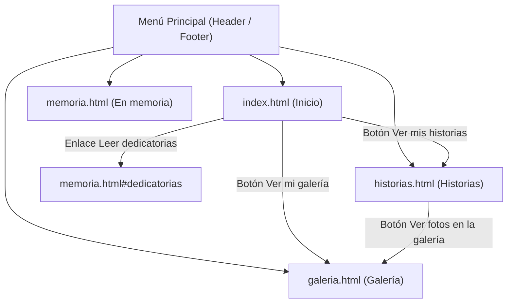

# Memorial de Bruno

Este proyecto es una web conmemorativa dedicada a Bruno, maquetada a partir del diseño hecho en Figma. La idea fue construir un sitio cálido para recopilar su esencia, sus historias por etapas, una galería de fotos y las dedicatorias de la familia.

## Qué se hizo en el proyecto

- **HTML semántico:** Se maquetaron las 4 páginas cuidando la estructura semántica (`header`, `nav`, `main`, `section`, `article`, `figure`, `figcaption`, `blockquote` y `footer`) y validando el código con la W3C.
- **SASS con metodología BEM:** Todos los estilos se trabajaron en `css/styles.scss` siguiendo la nomenclatura BEM (`bloque__elemento--modificador`). Se definieron variables para la paleta de colores, tipografías y los _breakpoints_ de las media queries (`$bp-sm`, `$bp-md`, `$bp-lg`).
- **Diseño responsive:** Se adaptaron las grillas y la línea de tiempo para móvil y tablet, incluyendo un menú móvil a pantalla completa que se abre desde el botón con icono de huella.
- **JavaScript (`js/main.js`):** Se agregó la lógica para abrir/cerrar el menú móvil, filtrar las historias y las fotos de la galería por categoría, y guardar en `localStorage` los contadores interactivos (caricias, huellitas, velas encendidas y favoritos) junto con un aviso flotante (_toast_).

## Estructura de carpetas

```text
├── index.html        # Página de inicio
├── historias.html    # Línea de tiempo con sus etapas
├── galeria.html      # Galería de fotos filtrable
├── memoria.html      # Homenaje y dedicatorias
├── css/
│   ├── styles.scss   # Archivo fuente SASS (BEM)
│   └── styles.css    # CSS compilado
├── js/
│   └── main.js       # Interacciones, filtros y contadores
└── img/
    └── ...           # Fotografías de Bruno e imágenes del proyecto
```

## Mapa de páginas y navegación

Todas las páginas están conectadas entre sí mediante el menú principal de la cabecera y el pie de página, además de enlaces directos en los botones de cada sección:


